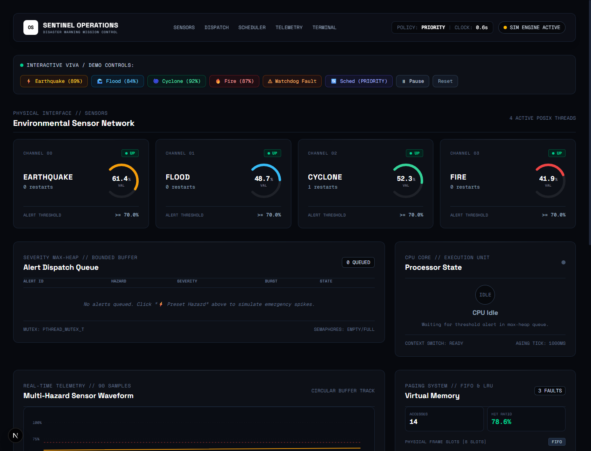
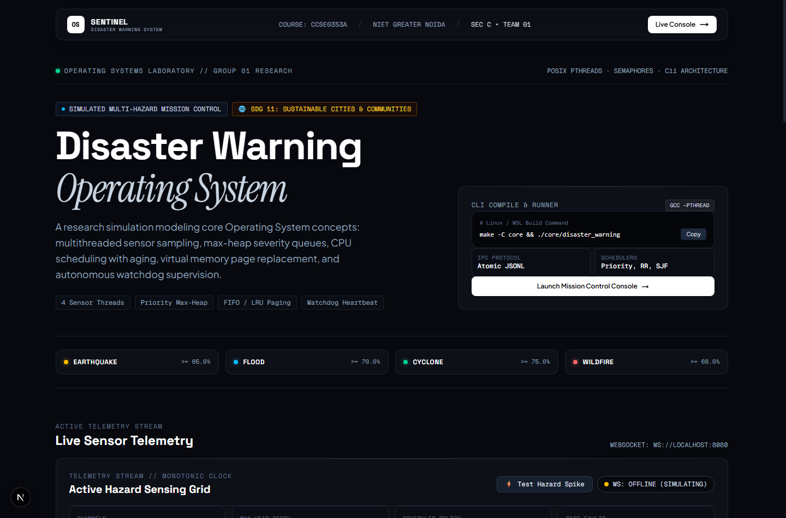
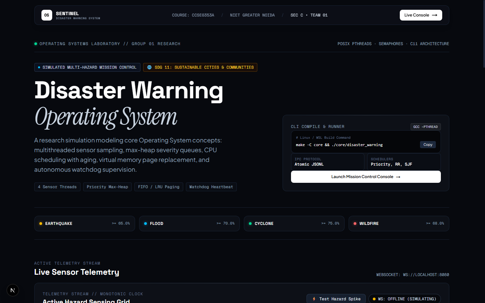
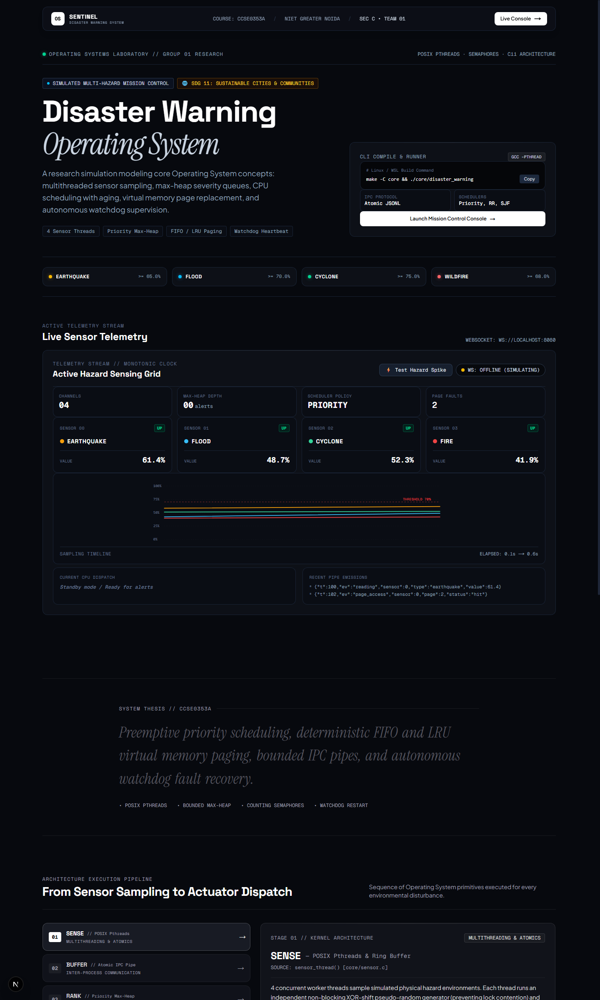
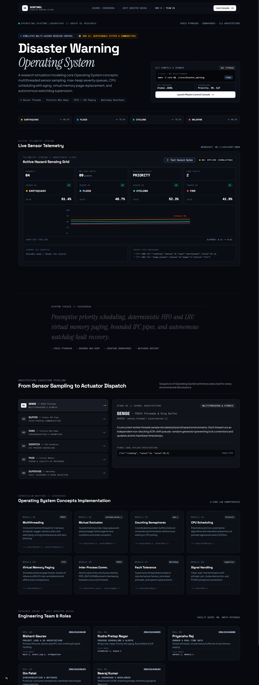
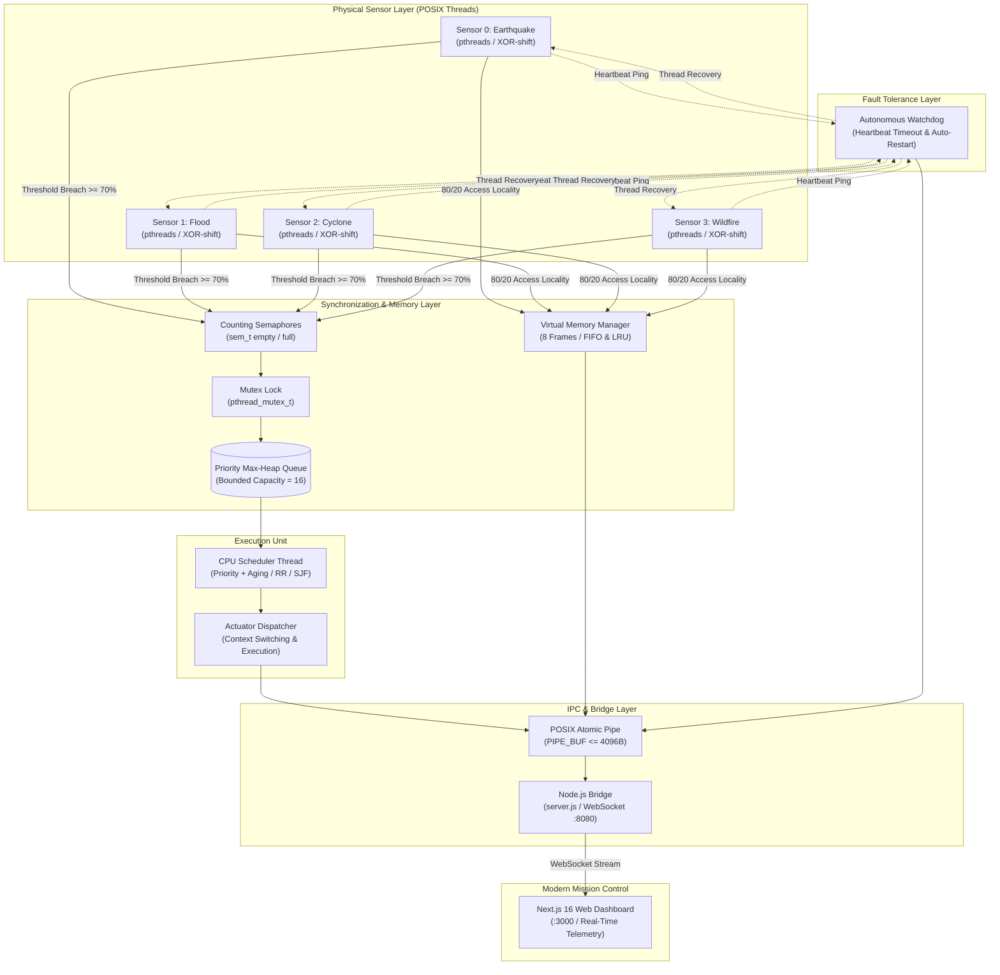

<div align="center">

# 🛡️ SENTINEL
### Smart Disaster Warning Operating System
**A Multithreaded Real-Time Operating System Simulation for Environmental Hazard Mitigation**

[](https://en.wikipedia.org/wiki/C11_(C_standard_revision))
[](https://pubs.opengroup.org/onlinepubs/9699919799/basedefs/pthread.h.html)
[](https://nextjs.org/)
[](https://tailwindcss.com/)
[](https://www.niet.co.in/)
[](https://sdgs.un.org/goals/goal11)

<p align="center">
  <b>B.Tech Project-Based Learning (PBL) — Course Code: CCSE0353A (Operating Systems)</b><br>
  Department of Computer Science & Engineering (Data Science) • Semester 3 • Section C • Team 01
</p>

</div>

---

## 📌 Academic Metadata & Verification

| Academic Parameter | Official Record Details |
| :--- | :--- |
| **Institution** | **Noida Institute of Engineering and Technology (NIET Greater Noida)** *(Autonomous Institute)* |
| **Department** | Department of Computer Science & Engineering (Data Science) |
| **Course Title** | **Operating Systems** |
| **Course Code** | **CCSE0353A** |
| **Academic Session** | 2026–2027 (3rd Semester, Section C) |
| **Project Title** | **Smart Disaster Warning System** |
| **Faculty / Guide** | **Ms. Amita Pathania** *(Assistant Professor & Course Coordinator)* |
| **SDG Alignment** | **UN Sustainable Development Goal 11:** *Sustainable Cities & Communities* |

---

## 👥 Engineering Team & Module Ownership

| S# | Student Name | University Roll No. | Assigned Engineering Role | Core C / System Files Owned |
| :---: | :--- | :---: | :--- | :--- |
| **1** | **Nishant Gaurav** | `2501331540190` | **Project Lead & OS Architecture** | `core/main.c`, `core/event_log.c`, Atomic Pipe IPC, Signal Lifecycle |
| **2** | **Rudra Pratap Nagar** | `2501331540225` | **Process Scheduling & Alert Management** | `core/scheduler.c`, `core/queue.c` (Max-Heap, Priority, RR, SJF) |
| **3** | **Priyanshu Raj** | `2501331540206` | **Sensor & Real-Time Data Module** | `core/sensor.c`, `core/memory.c` (pthreads, circular buffer, paging) |
| **4** | **Om Patel** | `2501331540193` | **Synchronization & Fault Tolerance** | `core/watchdog.c`, POSIX Mutexes & Counting Semaphores (`sem_t`) |
| **5** | **Neeraj Kumar** | `2501331540183` | **UI/Dashboard & Testing** | `bridge/server.js`, WebSocket streaming bridge, Next.js Mission Control |

---

## 📸 System Showcase & Visual Interface

### 1. Mission Control Center (`/dashboard`)
> Real-time environmental hazard monitoring, analog hardware radial gauges, priority max-heap alert dispatch, CPU execution state, and 8-slot physical frame matrix.



### 2. Multi-Hazard Sensing Grid (`/`)
> Live waveform stream plotting 90 samples of continuous telemetry across Earthquake, Flood, Cyclone, and Wildfire channels with 70% critical threshold breach line.



### 3. Hero Architecture & SDG 11 Alignment (`/`)
> Editorial typography (Instrument Serif & Space Grotesk), CLI compiler runner, and UN SDG 11 accreditation.



### 4. Interactive Kernel Architecture Pipeline
> 6-stage lifecycle tracing POSIX sensor sampling, IPC ring buffer, max-heap ranking, CPU dispatch, virtual memory paging, and watchdog supervisor recovery.



### 5. Curriculum Matrix & Engineering Team
> 8 Core OS lab competencies mapped directly to source files alongside official student roll numbers and guide credentials.



---

## 🔬 Core Operating System Concepts Implemented

Sentinel was built from the ground up to model fundamental Operating System primitives in pure C11 and POSIX standards:

### 1. Multithreading (`pthreads`)
- **Independent Worker Threads:** Each environmental hazard channel runs on a dedicated POSIX thread (`sensor_thread`).
- **Concurrent Execution:** Sensors sample physical models (Richter scale, water level, barometric pressure, temperature) concurrently without blocking the main event loop.
- **Thread Lifecycle:** Handled via `pthread_create()`, `pthread_join()`, and atomic control flags (`atomic_bool stop_requested`).

### 2. Mutual Exclusion (`pthread_mutex_t`)
- **Shared Priority Queue Protection:** Multiple concurrent sensor threads push alerts into a single shared max-heap. Race conditions are strictly prevented using `pthread_mutex_lock(&queue->mutex)`.
- **Memory Frame Integrity:** Accesses to the 8 physical frame registers are synchronized with `pthread_mutex_lock(&memory->mutex)`.

### 3. Counting Semaphores (Bounded Producer-Consumer)
- **Zero Busy-Waiting:** Producer-consumer coordination is managed with two POSIX semaphores:
  - `sem_t empty_slots`: Initialized to buffer capacity (e.g., 16). Decremented on push; producers sleep when full.
  - `sem_t full_slots`: Initialized to 0. Incremented on push; consumer scheduler sleeps when empty.
- **Deadlock-Free:** Guarantees CPU polling is eliminated and threads sleep until signaled.

### 4. Deadlock Avoidance (Hierarchical Lock Ordering)
- **Strict Hierarchy:** A global acquisition order is enforced across all modules:
  $$\text{queue\_mutex} \longrightarrow \text{memory\_mutex} \longrightarrow \text{event\_pipe}$$
- No thread ever holds `event_pipe` while requesting `queue_mutex`, eliminating Dijkstra's circular-wait condition entirely.

### 5. CPU Scheduling & Starvation Prevention (Aging)
- **Supported Algorithms:**
  - **Preemptive Priority:** Highest severity (Level 5 down to 1) executes first.
  - **Round Robin (RR):** Fixed time quantum slices (e.g., 100ms) with round-robin queue rotation.
  - **Shortest Job First (SJF):** Shortest burst time executed first.
- **Aging Mechanism:** Low-severity alerts that wait longer than $1000\,\text{ms}$ in the queue receive an automatic priority increment (`ev: "aged"`), preventing starvation under heavy alert storms.

### 6. Virtual Memory Paging & Page Replacement (FIFO / LRU)
- **Locality of Reference:** Models the **80/20 rule** (80% of sensor accesses hit pages 0–3, 20% hit pages 4–15).
- **Physical Frames:** Simulates 8 hardware frame registers.
- **Deterministic Eviction:** When a page fault occurs, the system selects a victim using either:
  - **FIFO (First-In, First-Out):** Circular replacement index.
  - **LRU (Least Recently Used):** Monotonic timestamp stack replacement.
- **Telemetry:** Real-time calculation of page accesses, page faults, and hit ratio ($>75\%$).

### 7. Inter-Process Communication (IPC Pipes)
- **Atomic POSIX Pipes:** Internal threads log events into a unidirectional POSIX pipe. Writes under `PIPE_BUF` (4096 bytes) are guaranteed atomic by the kernel, preventing line interleaving.
- **Bridge stdout Pipe:** The backend process emits single-line atomic JSONL to `stdout`, read line-by-line by the Node.js WebSocket bridge.

### 8. Fault Tolerance & Autonomous Watchdog Supervisor
- **Heartbeat Monitoring:** The watchdog thread wakes every $500\,\text{ms}$ and checks the atomic heartbeat timestamps of all sensor threads.
- **Chaos Recovery:** If a sensor thread hangs, deadlocks, or is terminated (simulated via `--inject-fault`), the watchdog detects `timeout > 1500ms`, joins the dead pthread, cleans up its state, and spawns a replacement thread automatically.

### 9. Signal Handling & Clean Termination (`sigaction`)
- **Safe Signal Handler:** `SIGINT` (Ctrl+C) is caught via `sigaction`.
- **Zero Leak Guarantee:** Sets `shutdown_requested = 1`, posts to semaphores to unblock sleeping consumers, joins all active pthreads, destroys mutexes and semaphores, and frees dynamic memory cleanly (verified with Valgrind / AddressSanitizer).

---

## 🏗️ System Architecture & Data Flow



---

## 📜 IPC Atomic JSONL Protocol Specification

Every system event emitted over the pipe adheres to a strict single-line JSON format:

| Event Type (`ev`) | Payload Schema | Description |
| :--- | :--- | :--- |
| `config` | `{"t":0,"ev":"config","sensors":4,"queue_size":16,"algo":"priority","frames":8}` | Kernel startup configuration |
| `reading` | `{"t":300,"ev":"reading","sensor":0,"type":"earthquake","value":64.2}` | Sensor physical sampling point |
| `alert_enqueued` | `{"t":310,"ev":"alert_enqueued","id":101,"sensor":0,"severity":5,"burst_ms":600}` | Severity threshold breach pushed to max-heap |
| `sched_start` | `{"t":320,"ev":"sched_start","id":101,"algo":"priority","severity":5,"burst_ms":600}` | CPU scheduler initiates task execution |
| `sched_end` | `{"t":920,"ev":"sched_end","id":101,"algo":"priority"}` | Task completed execution |
| `page_access` | `{"t":302,"ev":"page_access","sensor":0,"page":2,"status":"hit"}` | Page reference hit in physical frame |
| `page_fault` | `{"t":304,"ev":"page_fault","sensor":0,"page":7,"victim":2,"frames":[0,1,7,3,4,5,6,7]}` | Page fault; victim frame evicted |
| `mem_stats` | `{"t":1000,"ev":"mem_stats","accesses":42,"faults":5,"hit_ratio":0.88}` | Periodic memory locality statistics |
| `aged` | `{"t":1310,"ev":"aged","id":102,"new_severity":4}` | Starvation avoidance priority boost |
| `sensor_down` | `{"t":2500,"ev":"sensor_down","sensor":2,"type":"cyclone"}` | Watchdog detects heartbeat failure |
| `sensor_restarted`| `{"t":3700,"ev":"sensor_restarted","sensor":2,"restarts":1}` | Watchdog autonomously restarts dead thread |

---

## 📂 Repository Directory Layout

```
c:\Users\Nishant Gaurav\Downloads\os/
├── core/                              # C11 Kernel Implementation
│   ├── main.c                         # Thread bootstrap, CLI parsing, signal handling
│   ├── sensor.h / sensor.c            # Multithreaded sensor workers & physical models
│   ├── queue.h / queue.c              # Synchronized bounded max-heap priority queue
│   ├── scheduler.h / scheduler.c      # CPU schedulers (Priority, RR, SJF) & aging
│   ├── memory.h / memory.c            # Page table, FIFO/LRU replacement, 8 frames
│   ├── watchdog.h / watchdog.c        # Heartbeat supervisor & thread auto-restart
│   ├── event_log.h / event_log.c      # Atomic unidirectional POSIX pipe emitter
│   ├── logger.h / logger.c            # Pipe reader and stdout formatter
│   ├── sim_engine.js                  # Standalone high-fidelity cross-platform engine
│   └── Makefile                       # GCC compiler build rules (-Wall -Wextra -pthread)
├── bridge/                            # WebSocket Middleware Bridge
│   ├── server.js                      # Node.js WebSocket server & IPC child process
│   ├── test-client.js                 # Automated CLI client for stream validation
│   └── package.json                   # ws dependency configuration
├── dashboard/                         # Mission Control Web Console (Next.js 16)
│   ├── app/
│   │   ├── globals.css                # Obsidian carbon dark styling & micro-grid
│   │   ├── layout.tsx                 # 5 Google Fonts (Space Grotesk, Plus Jakarta, etc.)
│   │   ├── page.tsx                   # Sentinel Welcome & Architecture showcase
│   │   ├── dashboard/page.tsx         # Real-time mission control operations room
│   │   └── not-found.tsx              # Hardware-styled 404 console
│   ├── components/
│   │   ├── dashboard.tsx              # Main operations panel with demo toolbar
│   │   ├── welcome-page.tsx           # Hero page with curriculum and team badges
│   │   ├── welcome-preview.tsx        # Live batched waveform stream preview
│   │   ├── process-path.tsx           # 6-Stage interactive kernel architecture pipeline
│   │   ├── tagline-reveal.tsx         # High-craft editorial typography statement
│   │   └── ui/
│   │       ├── radial-gauge.tsx       # Analog hardware sensor gauges
│   │       ├── memory-matrix.tsx      # 8-Slot physical frame register visualizer
│   │       ├── spotlight-card.tsx     # Zero-render hardware-accelerated cursor spotlight
│   │       └── telemetry-terminal.tsx # Real-time POSIX pipe log stream with grep
│   ├── lib/mock-data.ts               # Baseline telemetry definitions
│   └── public/screenshots/            # High-resolution UI showcase images
├── docs/                              # Project Documentation
│   ├── disaster-warning-os-pbl.md     # Detailed OS PBL syllabus alignment specification
│   └── screenshots/                   # Exported documentation screenshots
├── .gitignore                         # Production gitignore rules
└── README.md                          # Comprehensive technical documentation
```

---

## 🚀 Quick Start & Execution Guide

### Mode A: Full Linux / WSL Execution (Native C Backend)

1. **Compile the C Kernel:**
   ```bash
   cd core
   make
   ```
2. **Start the WebSocket Bridge:**
   ```bash
   cd ../bridge
   npm install
   node server.js --auto-restart -- --sensors 4 --queue-size 16 --algo priority
   ```
3. **Launch the Next.js Mission Control Dashboard:**
   ```bash
   cd ../dashboard
   npm install
   npm run dev
   ```
4. **Open in Browser:**
   - Landing Page: [http://localhost:3000](http://localhost:3000)
   - Operations Console: [http://localhost:3000/dashboard](http://localhost:3000/dashboard)

---

### Mode B: Windows Standalone Execution (No GCC Required)

The project includes an automatic fallback simulation engine (`core/sim_engine.js`) that runs seamlessly on Windows:

1. **Start the Bridge:**
   ```powershell
   cd bridge
   npm install
   node server.js
   ```
2. **Start the Frontend Dashboard:**
   ```powershell
   cd dashboard
   npm install
   npm run dev
   ```
3. **Open:** [http://localhost:3000/dashboard](http://localhost:3000/dashboard)

---

## 🎤 Step-by-Step Viva / Presentation Demonstration Script

When presenting to the faculty or external examiners, follow this 5-step demonstration:

| Step | Examiner Demonstration Action | What to Explain to the Examiner |
| :---: | :--- | :--- |
| **1** | Open [http://localhost:3000](http://localhost:3000) | Highlight **NIET Greater Noida**, **CCSE0353A**, and **SDG 11 Alignment**. Show the live telemetry waveform flowing across 4 sensor channels. |
| **2** | Scroll to **Kernel Architecture Pipeline** | Explain the 6-stage lifecycle from POSIX threads sampling down to Watchdog supervision. Reference specific C source files (`sensor.c`, `queue.c`, etc.). |
| **3** | Click **"Launch Mission Control Console"** | Navigate to `/dashboard`. Show the analog radial gauges moving with live values and the physical frame register matrix. |
| **4** | Click **`⚡ Earthquake (89%)`** | Demonstrate emergency preemption: a critical Level 5 alert is pushed to the bounded max-heap, preempts the CPU, and executes on the Gantt timeline. |
| **5** | Click **`⚠ Watchdog Fault`** | Show autonomous recovery: thread failure is detected, logged in the audit panel, joined via `pthread_join`, and respawned automatically. |
| **6** | Click **`🔄 Sched (Cycle)`** | Switch between **Priority**, **Round Robin**, and **SJF** live without stopping the simulation. |

---

## ⚖️ License & Academic Integrity

This project is authored by **Team 01 (Section C, B.Tech Data Science 2026–2027)** at **Noida Institute of Engineering and Technology (NIET Greater Noida)** for the course **Operating Systems (CCSE0353A)** under the guidance of **Ms. Amita Pathania**. 

Licensed under the [MIT License](LICENSE).
